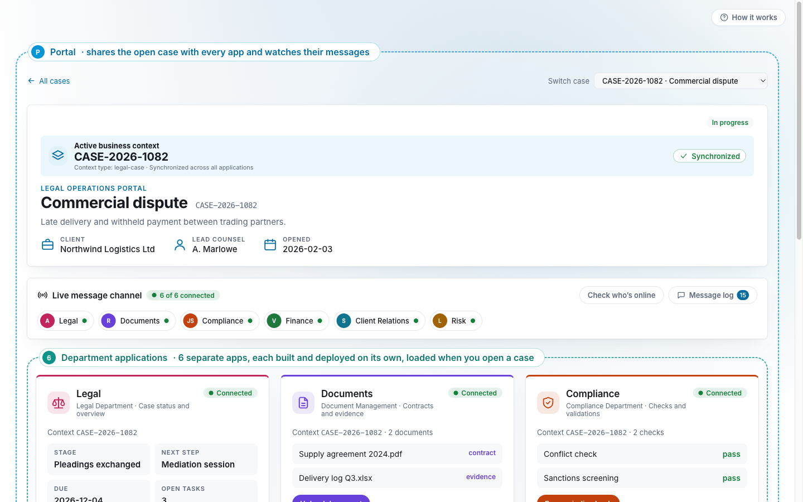

# Frontend Orchestration Platform

A framework-agnostic platform for running independently deployed microfrontends together on one page, at runtime.

A **shell portal** discovers the microfrontends from a JSON manifest, loads them dynamically by URL, mounts them through custom elements, and lets them coordinate using browser-native, typed event contracts. The shell portal has no compile-time knowledge of individual microfrontends and treats them as black boxes.

**Terms used in this project**

- **Frontend Orchestration Platform**: the whole project (this repository and its live demo).
- **Shell portal**: the host app that reads the manifest, loads the apps and draws the frame around them. It is built with Angular here, but any framework could play this role.
- **Apps** (microfrontends, MFEs): the independently deployed frontends the shell portal loads (six in the demo).
- **Manifest**: the JSON file that lists the apps and how to load and present them.
- **Scenario**: the JSON file that gives the demo its business meaning (records, departments, labels). The shell treats it as opaque data; the demo scenario is Legal Case Management.
- **Context**: the record the user opened (`contextType`, `contextId`, `routeId`). The shell owns it; apps follow it.
- **`@stavgian/mfe-communication`**: the npm library the apps use to talk to each other.



> **This is a demo.** It exists to show a pattern and the reasoning behind it, not to be production software. Expect rough edges; if you find a bug, please [open an issue](https://github.com/stavgian/frontend-orchestration-platform/issues).

## What this project demonstrates

- Runtime discovery and loading of microfrontends via a manifest
- A shell portal that composes distributed frontends (built with Angular here; any framework could host)
- Custom elements as a framework-agnostic integration boundary
- Typed, event-based cross-microfrontend communication
- Independent build and serve of MFEs within an Nx workspace
- Boundaries between the shell portal and the microfrontends: separate packages and runtime-only coupling

## High-level architecture

The platform owns orchestration, the scenario owns business meaning, each app owns its functionality.

- **Shell portal (Angular)**: generic. It knows applications, manifests, contexts, routes, events and presence, and nothing about cases, claims or employees.
  - Loads the manifest and the scenario at runtime and loads every compatible app by URL and custom element name
  - Routes: `/` (the scenario's records) and `/:contextId` (the generic context page). Unknown ids redirect to `/`
  - Owns the active context. Navigation changes it; the shell broadcasts `context:changed` and answers `context:get`. Apps never touch the route
  - Switching between contexts keeps every app mounted: nothing reloads, apps just receive the new context
  - If an app fails to load, its frame says so and offers **Try again**; the other apps keep working
  - Does not import or reference MFE code at build time
- **Scenario (`apps/portal/src/assets/scenario.json`)**: name, description, labels, the records (type, id, title, status, summary, fields), and which manifest apps take part with their department and responsibility, plus the example events (documentation only).
- **Microfrontends (MFEs)**: independent, each with its own `package.json`, a custom element as public API, and `@stavgian/mfe-communication` as the only shared code. Each keeps its own mock data keyed by context id.

| App | Department | Framework | Loaded as |
| --- | --- | --- | --- |
| `angular-mfe` Legal | Legal department | Angular 22, zoneless, Angular Elements | Module Federation–style remote container |
| `react-mfe` Documents | Document management | React 19 | script tag |
| `js-mfe` Compliance | Compliance department | Plain JS native Web Component | script tag |
| `vue-mfe` Finance | Finance department | Vue 3.5, `defineCustomElement` | script tag |
| `svelte-mfe` Client Relations | Client services | Svelte 5 custom element | script tag |
| `lit-mfe` Risk | Risk management | Lit 3 | script tag |

Each app reports its framework and version at runtime (presence `meta`); the shell shows it in the app's "Built with" footer without knowing it at build time.

- **Shared library**: [`@stavgian/mfe-communication`](libs/mfe-communication) (published to npm): events, requests with answers, and presence over browser-native events. Unchanged by this demo.

## Context synchronization

1. The user opens `/CASE-2026-1083`. The context page looks the id up in the scenario and calls `ContextService.activate({ contextType, contextId, routeId, correlationId })`.
2. The shell publishes `context:changed` (broadcast). Apps already loaded update themselves.
3. An app that loads later (first visit, or slow network) sends `request('context:get', …, { to: 'portal' })` when it connects and gets the current context, or `null` when none is active.
4. Moving to another record only repeats step 2. Moving back to `/` unmounts the apps, which disconnect from the channel.

The same contract works for any domain: `contextType` and `contextId` are opaque strings.

## Example event flows (Legal Case Management)

These event names belong to the scenario, not the platform. The shell monitor shows them as generic envelopes.

| Flow | What happens |
| --- | --- |
| Documents → Compliance, Risk, Client Relations → Legal | "Upload document" publishes `document:uploaded`. Compliance screens it and publishes `compliance:check:completed`; Risk raises the score and publishes `risk:assessment:updated`; Client Relations logs it; Legal shows the latest check and risk. |
| Finance → Risk, Client Relations | "Log 1.5 h" publishes `billing:updated`; Risk adjusts the score, Client Relations logs a draft invoice. |
| Legal ⇄ Risk (request/response) | Legal asks `risk:get-score` from `lit-mfe` when a context opens, when Risk comes online and on "Ask Risk". Risk answers with `respond()`. |

## How to introduce another scenario

No shell change is needed.

1. Write a new `scenario.json`: context type, records, labels, the apps with department/responsibility/`contextTypes`, example events.
2. Write a manifest listing the apps (`manifest.dev.json` / `manifest.prod.json`).
3. Implement the MFEs. Each subscribes to `context:changed`, requests `context:get` on connect and declares its own events.

For example an insurance scenario would use `contextType: 'insurance-claim'` and `contextId: 'CLM-2026-00421'` with Claims, Policy, Documents, Risk, Legal and Finance apps.

## Runtime manifest

The shell portal reads a JSON manifest at runtime that describes available MFEs: `id`, `display` (name, initials, colour, optional logo), `type` (`module-federation` or `script`), `customElement`, and either `scripts` or `remoteEntry`/`remoteName`/`exposedModule`.

Dev manifest (`apps/portal/src/assets/manifest.dev.json`) ports: Angular 4301, React 4302, JS 4303, Vue 4304, Svelte 4305, Lit 4306. The production manifest uses relative URLs (`./<id>/<file>.js`), resolved against `<base href>`, so GitHub Pages sub-paths work.

## Cross-microfrontend communication

Communication is based on browser-native `CustomEvent`s published on `window`, wrapped by the [`@stavgian/mfe-communication`](libs/mfe-communication) package.

The demo uses these patterns:

| Pattern | In the demo |
| --- | --- |
| **Event**: "something happened" | `document:uploaded`, `billing:updated`, `compliance:check:completed`, `risk:assessment:updated` (see the flows above). |
| **Request**: "I need an answer" | Legal asks Risk for the score (`risk:get-score`); every app asks the shell for the current context (`context:get`). |
| **Direct message**: "just for you" | `publish(…, { to: '<id>' })` reaches one app only. The shell's context requests use it. |
| **Presence**: "who's here?" | The shell shows which apps are connected and which framework each reports. Legal re-asks Risk when Risk joins late. "Check who's online" pings every app. |

How it works:
- Each app calls `connect({ id })`, which announces it on the channel (`system:ready`) and discovers apps already connected (`system:present`). `disconnect()` announces `system:left`.
- Every message is an envelope `{ specversion, id, type, source, time, payload }`. Apps choose their own types and declare the payloads they use with TypeScript declaration merging. No shared types package is needed.
- Subscriptions take an exact type, a namespace (`document:*`) or everything (`*`).
- The shell portal and every MFE depend on the package by version (`^2.0.0`), never on each other's code. Each connection keeps only its own state, so apps on different library versions still talk as long as they share the same `specversion`.

On one page, the shell portal shows everything live:
- the manifest it loaded the apps from: which apps, how each one is loaded, and from where
- which apps are connected (floating in the top corner) and, in each app's footer, what it is built with
- a compact channel strip showing which apps are connected and who sent, was asked or answered
- a full-height message log sidebar you can toggle and filter
- toasts while the log is closed

Every app renders inside its own Shadow DOM, so the shell portal's CSS can't reach in and an app's CSS can't leak out. The shell portal has no business logic. It never sends business messages; it only loads apps and observes the channel through the library. Everything the apps do, they do with each other.

See the [package README](libs/mfe-communication/README.md) for the full API.

### How the pieces depend on each other

```
@stavgian/mfe-communication  (npm, semver)
   ▲        ▲          ▲          ▲         ▲
portal  angular-mfe  react-mfe  js-mfe  vue-mfe  svelte-mfe  lit-mfe   ← each pins its own version range
```

In this repo, npm workspaces link the local library source to each app, as long as the library's version satisfies that app's range. An app can stay on `^2` while the library moves to `3.x`, in which case it installs `2.x` from npm instead.

## Adding an app

An app is anything that registers a custom element and talks through `@stavgian/mfe-communication`. To add one, for example a second Angular app on another Angular version:

1. Create `mfes/<name>/` with its own `package.json`. Its dependencies are its own, so a second Angular app can pin a different major version than the first; npm installs it inside that workspace.
2. Build it into a single script that defines the custom element (see the existing `build.mjs` files).
3. Call `connect({ id, name, meta: { framework: …, element: … } })` and use events, requests or presence like the others.
4. Add an entry to `apps/portal/src/assets/manifest.dev.json` and `manifest.prod.json`, and list the app in `scenario.json` under `apps` with its department and `contextTypes`. The shell portal needs nothing else.
5. Give it a `display` block in the manifest entry (`name`, `initials`, `color`, and optionally a `logo` image URL). The shell portal takes how it presents each app from the manifest, so it has no code per app.

Two Angular apps already share this page: the shell portal runs with zone.js, and `angular-mfe` runs without it (zoneless change detection with signals). Each brings its own Angular runtime inside its own bundle, so they can be on different Angular versions and neither upgrade blocks the other.

## Repository structure

```
apps/
  portal/

libs/
  mfe-communication/   ← published to npm as @stavgian/mfe-communication

mfes/
  angular-mfe/
  react-mfe/
  js-mfe/
  vue-mfe/
  svelte-mfe/
  lit-mfe/
```

## The apps

Each app builds and serves on its own.

### JS MFE (native Web Component)

Plain JavaScript, no framework. A tiny esbuild step bundles `@stavgian/mfe-communication` into a single file:

```bash
npm run build:js-mfe   # produces mfes/js-mfe/dist/js-mfe.js
npm run serve:js-mfe   # builds then serves on http://localhost:4303/js-mfe.js
```

The shell portal manifest points to http://localhost:4303/js-mfe.js.

### React MFE (React root in a custom element)

React 19. A small `HTMLElement` class creates a React root when the element is attached and unmounts it when the element is removed.

Build and serve it:

```bash
npm run build:react-mfe   # produces mfes/react-mfe/dist/react-mfe.js
npm run serve:react-mfe   # builds then serves on http://localhost:4302/react-mfe.js
```

The shell portal manifest (`apps/portal/src/assets/manifest.dev.json`) points to http://localhost:4302/react-mfe.js.

### Angular MFE (Angular Elements, Module Federation–style remote)

Angular 22, zoneless, with signals. esbuild bundles it into `remoteEntry.js`, which registers a small container on `window.angularMfe`; the shell portal calls its `./bootstrap` module, which defines the custom element with Angular Elements. It is the same shape as a Module Federation remote, without webpack.

Build and serve it:

```bash
npm run build:angular-mfe   # outputs mfes/angular-mfe/dist/remoteEntry.js
npm run serve:angular-mfe   # builds then serves on http://localhost:4301/remoteEntry.js
```

The shell portal manifest (`apps/portal/src/assets/manifest.dev.json`) points to http://localhost:4301/remoteEntry.js with `remoteName: angularMfe`, `exposedModule: ./bootstrap`, `customElement: angular-mfe`.

### Vue MFE (`defineCustomElement`)

Vue 3.5, written with render functions, turned into a custom element by Vue's `defineCustomElement`:

```bash
npm run build:vue-mfe   # produces mfes/vue-mfe/dist/vue-mfe.js
npm run serve:vue-mfe   # builds then serves on http://localhost:4304/vue-mfe.js
```

## Releasing `@stavgian/mfe-communication`

Releases are made from this repo. A pushed tag triggers [`.github/workflows/publish-mfe-communication.yml`](.github/workflows/publish-mfe-communication.yml), which builds, tests and publishes with npm trusted publishing (no npm token stored, provenance attached).

```bash
npx nx release minor --skip-publish -g mfe-communication   # or patch / major: bumps version, writes CHANGELOG, commits, tags mfe-communication@x.y.z
git push --follow-tags                # the tag starts the publish workflow
```

Pick the bump by what changed in the payload format: patch for fixes, minor for new events or optional fields, major for renamed/removed fields or new required fields.

Run the library's tests locally with `npm run test:mfe-communication`.

## Releasing the shell portal

The shell portal has its own semver version in [`apps/portal/package.json`](apps/portal/package.json), shown in the page footer. Bump it on every portal release:

```bash
npx nx release patch --skip-publish -g portal   # add --first-release the first time; or minor / major: bumps version, writes apps/portal/CHANGELOG.md, commits, tags portal@x.y.z
git push --follow-tags
```

### Svelte MFE (Svelte custom element)

Svelte 5 compiled with `customElement: true` through `esbuild-svelte`; the component declares its own tag.

```bash
npm run build:svelte-mfe   # produces mfes/svelte-mfe/dist/svelte-mfe.js
npm run serve:svelte-mfe   # http://localhost:4305/svelte-mfe.js
```

### Lit MFE (LitElement)

```bash
npm run build:lit-mfe   # produces mfes/lit-mfe/dist/lit-mfe.js
npm run serve:lit-mfe   # http://localhost:4306/lit-mfe.js
```

## Running locally

### One command (recommended)
```bash
npm run serve:all
```
Starts Angular MFE (4301), React MFE (4302), JS MFE (4303), Vue MFE (4304), Svelte MFE (4305), Lit MFE (4306) and the shell portal with prefixed logs.

### Manual start (individual terminals)
```bash
npm run serve:angular-mfe   # 4301 -> remoteEntry.js
npm run serve:react-mfe     # 4302 -> react-mfe.js
npm run serve:js-mfe        # 4303 -> js-mfe.js
npm run serve:vue-mfe       # 4304 -> vue-mfe.js
npm run serve:svelte-mfe    # 4305 -> svelte-mfe.js
npm run serve:lit-mfe       # 4306 -> lit-mfe.js
NX_DAEMON=false npm run serve:portal
```

The shell portal manifest (`apps/portal/src/assets/manifest.dev.json`) points to those URLs. Adjust the URLs there if you change ports.

`serve:all` stops every server when one of them stops. To see the "Could not load this app" state and **Try again**, start the servers individually, leave one out, then start it and press **Try again**.

## Deploying to GitHub Pages

This repo builds a single Pages artifact with separate URLs for the shell portal and each MFE.

- Shell portal: `/REPOSITORY_NAME/`
- Angular MFE: `/REPOSITORY_NAME/angular-mfe/`
- React MFE: `/REPOSITORY_NAME/react-mfe/`
- JS MFE: `/REPOSITORY_NAME/js-mfe/`
- Vue MFE: `/REPOSITORY_NAME/vue-mfe/`

Each MFE folder also has a standalone page that runs the app on its own.

Build the Pages artifact locally:

```bash
npm run build:github-pages
```

The generated output is written to `dist/github-pages`.

Notes:
- The shell portal production build uses `apps/portal/src/assets/manifest.prod.json`, which points to the deployed MFE folders with relative URLs.
- The build script automatically sets the shell portal base href to the repository name when running in GitHub Actions.
- The repository includes `.npmrc` with `legacy-peer-deps=true` because the current Nx/Angular toolchain and pinned `esbuild` version do not install cleanly with strict peer resolution.
- If you want to override the deployment base path manually, set `PAGES_BASE_PATH` before running the build.

Examples:

```bash
PAGES_BASE_PATH=my-repo npm run build:github-pages
PAGES_BASE_PATH=/ npm run build:github-pages
```

The workflow in `.github/workflows/deploy-pages.yml` publishes `dist/github-pages` to GitHub Pages on pushes to `main`.

## Design principles

- No compile-time coupling between the shell portal and the MFEs
- Browser-native primitives over framework-specific APIs
- Explicit contracts over implicit integration
- Runtime composition over build-time wiring
- Replaceable implementation details

## License

MIT. See [LICENSE](LICENSE).
